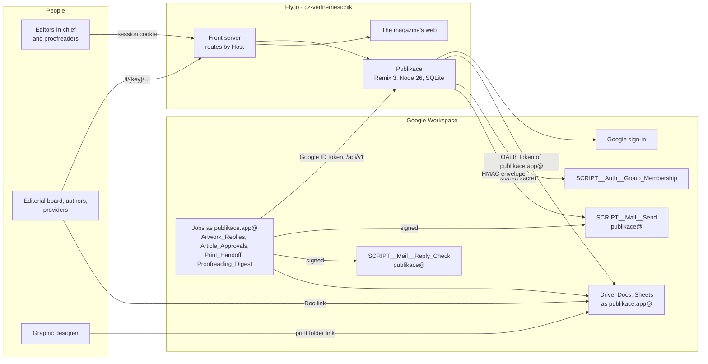
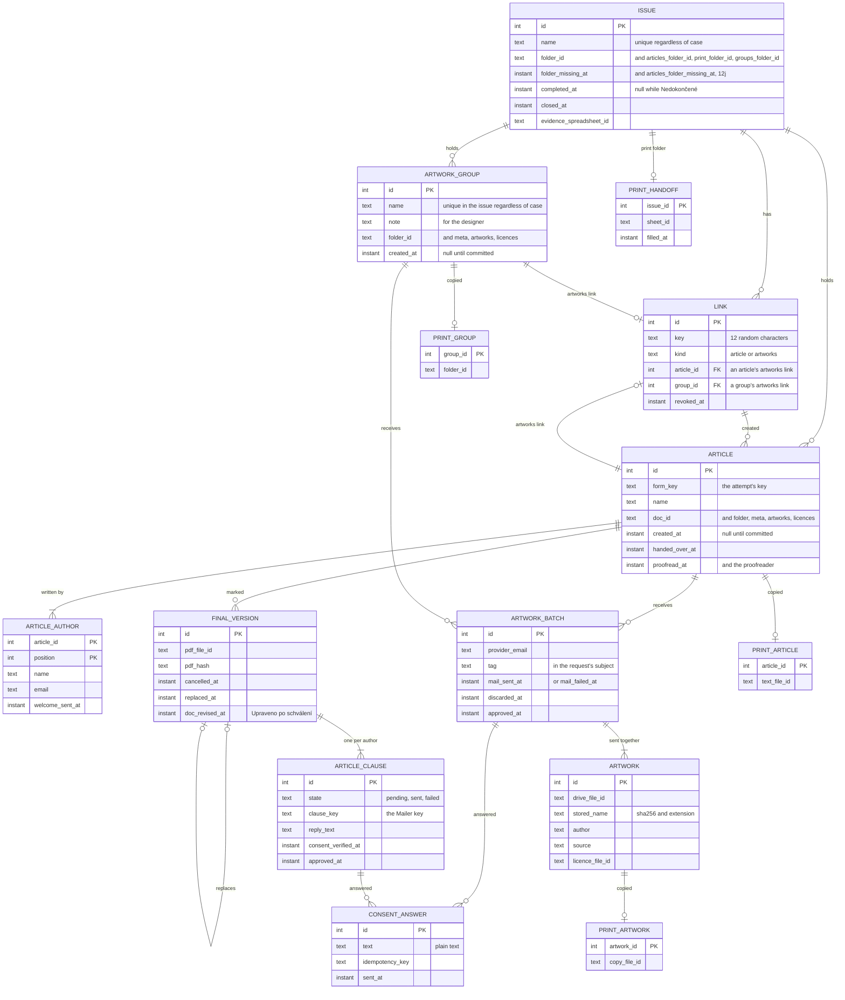
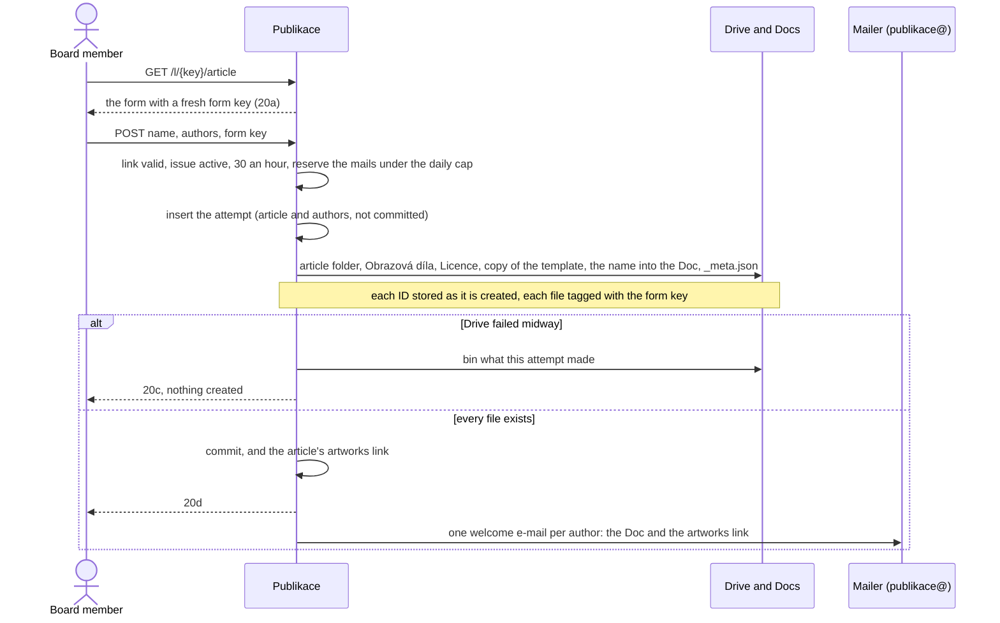
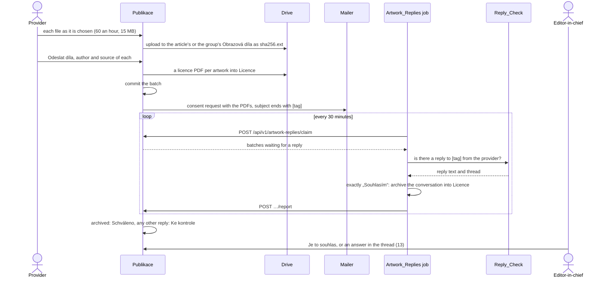
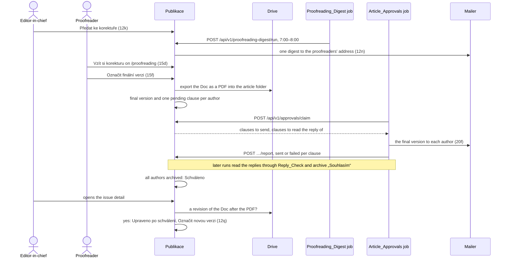
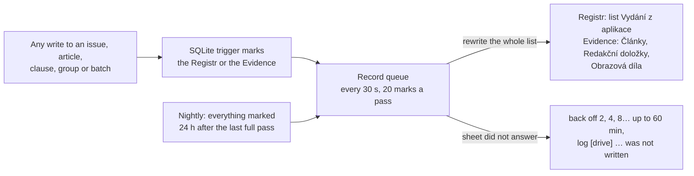

# Architecture

How Publikace is built and how it talks to Google and to the Apps Script jobs. The rules behind
it are in [product.md](product.md) and [security.md](security.md). Where the plan and the code part
ways today: [review-2026-11-24.md](review-2026-11-24.md).

## Context

## The stack and where it runs

- **Remix 3** with server rendering and a few hydrated islands, on **Node 26**: `Temporal`,
  `node:sqlite`, and TypeScript stripping with no build step.
- **SQLite** at `DATABASE_PATH`. `createPublikace` applies pending migrations from
  `db/migrations` before the app answers ([migrations.md](migrations.md)). One process on one
  machine is the whole deployment, which is what makes migrating at startup safe.
- **The design system** is copied into `app/ui/public/ds/`. Components write its `vdm-*` markup.
- **`createPublikace(environment)`** in `app/publikace.server.ts` is the whole app as
  `{ fetch, close }`. It owns no process. A misconfiguration rejects before anything is opened.
  `server.ts` is the host for working on this repository alone (port 44100).
- **Production** (#79, not running yet): one more host behind the front server of the Fly app
  `cz-vednemesicnik`, after this repository moves into that one as a package. Publikace keeps its
  own SQLite file on the machine's volume. A secret whose value differs from the web's carries a
  prefix, because one Fly app has one namespace of secrets.

## Identities

| Identity                                                    | Used for                                                              | Never used for                                                |
| ----------------------------------------------------------- | --------------------------------------------------------------------- | ------------------------------------------------------------- |
| The signed-in editor or proofreader                         | proving who they are at sign-in (OAuth code flow, userinfo)           | any Drive or Gmail call                                       |
| `publikace.app@` (stored refresh token, full `drive` scope) | folders, Docs, PDFs, uploads, the bin, the Registr and every Evidence | mail; any drive other than _Publikace_ and its own _Můj disk_ |
| `publikace.app@` (as the jobs' Google ID token)             | proving to `/api/v1` that a call comes from a job                     | —                                                             |
| `publikace@` (through the Mailer and the reply check)       | every e-mail; reading the replies                                     | — the app never holds its credentials                         |
| The membership service's secret                             | asking whether an account is in a listed group                        | anything else; it answers only for listed groups              |

Only `DRIVE_ACCOUNT_EMAIL` can be connected in Nastavení (`14g`, `14h`). A disconnected account
blocks every action that creates files, and a banner over every screen says so (`14c`).

## Data model

States are not stored as enums. They are derived from timestamps such as `handed_over_at`,
`consent_verified_at` and `closed_at` (see [Lifecycles](#lifecycles)). The diagram shows the
tables that carry the product. Sessions, the access list, the proofreaders' address, the Drive
account, `job_runs` and the record queue's own tables stand beside them.

An artworks link, a batch and an artwork belong to exactly one article or one artwork group, which
a `CHECK` on each table holds (#133). Code that does not care which reads both as a _holder_:
the folder with `Obrazová díla` and `Licence` in it, and the name the e-mails and the record show.

## Flows

### An article from the newsroom link

The same form key sent again answers with the same page and sends nothing a second time.

### Artworks and their consent

### Proofreading, the final version and the authors' consent

### The record

The app writes the record after the database, never inside an action. A sheet that does not
answer delays the record and blocks nothing. The app writes only its own list, puts its
protection back before every write, and never reads a sheet. A column the record begins to
show needs its trigger changed in a new migration. A group's artworks are rows of _Obrazová díla_
with the group's name in _Název článku_ and its folder in _ID složky_, as the scripts write them,
and the Registr's _URL – Vytvořit skupinu obrazových děl_ stays empty: the app hands out no link
that creates groups (`03` row 6).

## Lifecycles

| Thing          | Derived from                                                                                          | In `app/domain/`   |
| -------------- | ----------------------------------------------------------------------------------------------------- | ------------------ |
| Issue          | `completed_at` (Nedokončené without it), `closed_at`                                                  | `issue.ts`         |
| Article        | handover and take columns; with a final version standing, the counts of its clauses; `doc_revised_at` | `article.ts`       |
| Clause         | stored `pending/sent/failed`, then the reply, `consent_verified_at`, `approved_at`, archive failure   | `approvals.ts`     |
| Artwork batch  | `mail_sent_at` or `mail_failed_at`, the reply, `consent_verified_at`, `approved_at`, `discarded_at`   | `artwork.ts`       |
| Artwork upload | no `batch_id` while unsent; `removed_at`; binned 24 h after upload if still unsent                    | `artwork.ts`       |
| Artwork group  | `created_at`; no state of its own, never deleted                                                      | `artwork-group.ts` |
| Link           | valid; gone once revoked or its issue closed; a key never issued draws the same page                  | `link.ts`          |

## Background work

**In the app's process**

| Work                  | When                                                           | Does                                                            |
| --------------------- | -------------------------------------------------------------- | --------------------------------------------------------------- |
| Record queue          | every 30 s, and everything again 24 h after the last full pass | writes the Registr and each Evidence from the database          |
| Cleanup after a crash | at startup and at the next send through the same path          | bins uncommitted article and group attempts and artwork batches |
| Unsent uploads        | at startup and on every upload                                 | bins uploads that waited 24 hours unsent                        |

**Apps Script jobs that talk to the app**, all as `publikace.app@` on their own triggers:

| Job                                        | Interval         | API                                 | Exists                      |
| ------------------------------------------ | ---------------- | ----------------------------------- | --------------------------- |
| `SCRIPT__Publication__Artwork_Replies`     | 30 min           | `artwork-replies/claim`, `…/report` | yes                         |
| `SCRIPT__Publication__Article_Approvals`   | 30 min           | `approvals/claim`, `…/report`       | locally, not deployed (#96) |
| `SCRIPT__Publication__Print_Handoff`       | 6 h              | `print-handoff/claim`, `…/report`   | no (#119)                   |
| `SCRIPT__Publication__Proofreading_Digest` | daily, 7:00–8:00 | `proofreading-digest/run`           | no (#86)                    |

Every claim opens a run in `job_runs` and leases what it returns for 10 minutes. A report must
carry the run's key. Every e-mail carries a Mailer idempotency key, so a run that dies between
sending and reporting does not send twice. `/settings/jobs` shows each job's last run (`14d`).
Once two runs in a row fail or overdue, a banner appears over every editor's screen; for the
digest, one run is enough (`14i`).

**The API is a contract with the scripts.** It is versioned (`/api/v1`), and a field is never
renamed in place. A change to what an endpoint takes or returns is a change in the script too.
Artwork groups were added that way (#133): `artwork-replies/claim` gives each batch a `kind`
(`article` or `artwork-group`) beside `articleName`, which carries the group's name for a group,
and `print-handoff/claim` gives each issue its `groups` with their notes, which `…/report` takes
back the same way and a job written before groups leaves out.

## Configuration

[.env.example](../.env.example) documents every variable by name and purpose. In production,
`createPublikace` refuses to start when any of them is missing. There is one exception:
`REGISTRY_SPREADSHEET_ID` is optional until the cutover, and without it the app writes only the
Evidence.

| Group            | Variables                                                                                                               |
| ---------------- | ----------------------------------------------------------------------------------------------------------------------- |
| Sign-in          | `APP_ORIGIN`, `AUTHORIZED_DOMAIN`, `GOOGLE_CLIENT_ID`, `GOOGLE_CLIENT_SECRET`, `SESSION_SECRET`, `INITIAL_ADMIN_EMAIL`  |
| Group membership | `GAS_GROUP_MEMBERSHIP_URL`, `GAS_GROUP_MEMBERSHIP_SECRET`                                                               |
| Drive            | `DRIVE_ACCOUNT_EMAIL`, `DRIVE_TOKEN_KEY`, `ISSUES_FOLDER_ID`, `ARTICLE_TEMPLATE_DOCUMENT_ID`, `REGISTRY_SPREADSHEET_ID` |
| Mail             | `MAIL_SEND_URL`, `MAIL_SEND_SECRET`, `PUBLIC_MAIL_PER_DAY`                                                              |
| Jobs             | `SCRIPT_TOKEN_AUDIENCE`, `SCRIPT_JOB_ACCOUNT`, `SCRIPT_RUN_SECRET` (not read yet, see the review)                       |
| Storage          | `DATABASE_PATH`                                                                                                         |

## Testing without Google

`pnpm app:fake` runs the app on fakes of Drive, the Mailer, the membership service and the jobs,
bound to `127.0.0.1:44110`, with `/_fake` for switching their answers. The suite uses the same
fakes. What only the real services can show is tried by hand, as
[real-drive-round-trip.md](real-drive-round-trip.md) lays out.
