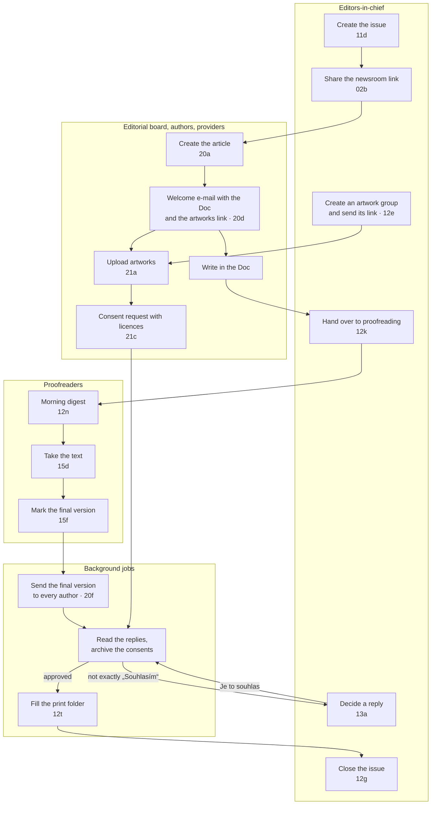
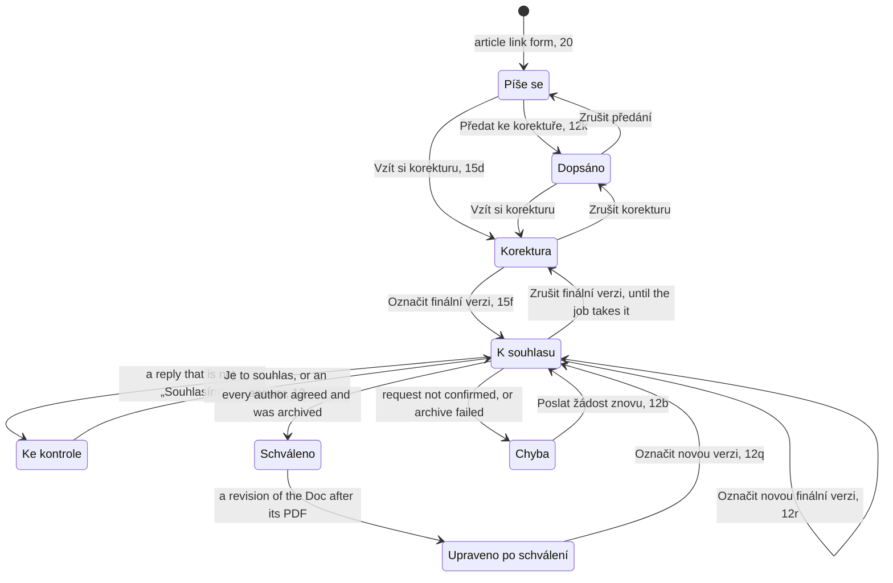
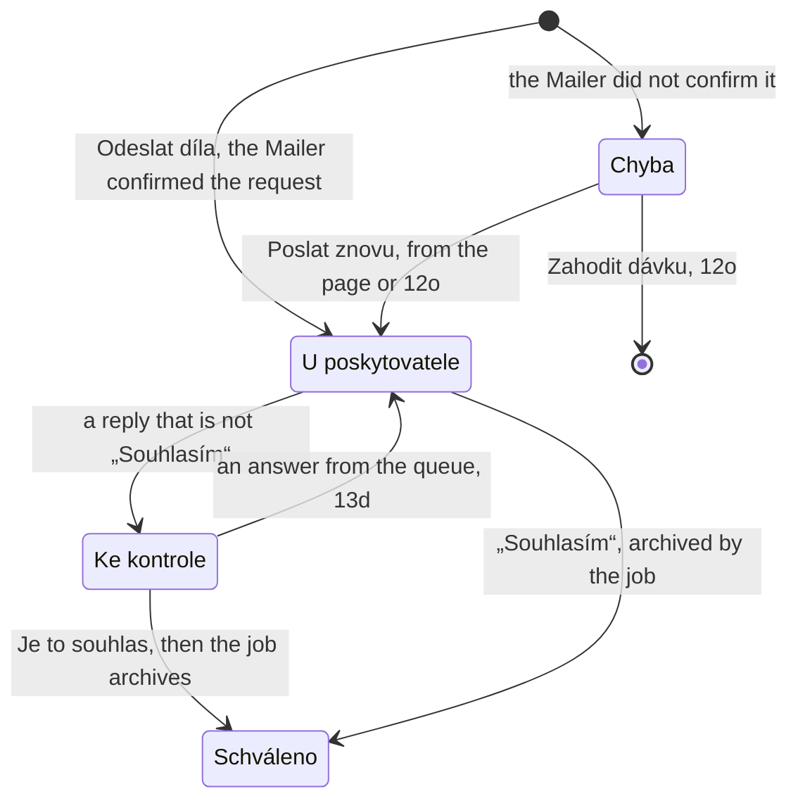
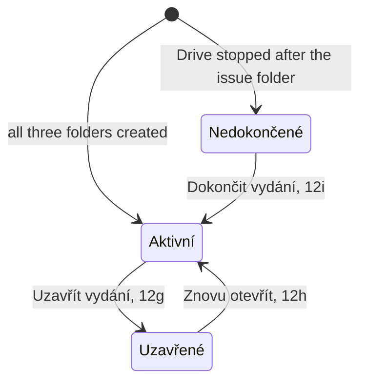

# Product

What Publikace does, for whom, and the rules every screen follows. The screens are in the
design canvas ([design-project.md](design-project.md)). Anchors such as `12a` point to it, and
the canvas's `01 Stavy a souhlasy` is the source of truth for every status tag. How it is built:
[architecture.md](architecture.md). What it protects: [security.md](security.md). Where design,
product and code disagree today: [review-2026-11-24.md](review-2026-11-24.md).

## Purpose

Vedneměsíčník is a student magazine. An issue gathers articles from the editorial board and
artworks from their providers, and each text and each artwork needs a written consent before it
goes to print. Until now, Apps Script web pages and jobs did this over the Registr and the
Evidence sheets, and the editors-in-chief watched the sheets to see where things stood.

Publikace replaces those pages with one app, `publikace.vednemesicnik.cz`. There:

- the editors-in-chief create an issue and its artwork groups, and send out their links;
- they see every article and artwork of the issue on one screen;
- they decide the replies that were not exactly „Souhlasím“;
- the proofreaders take their texts.

Writing stays in the Google Doc, a consent stays an e-mail reply, and the print folder stays a
Drive folder.

## People

| Who                        | How they get in                                                                                              | What they can do                                                                                                                                                                                 |
| -------------------------- | ------------------------------------------------------------------------------------------------------------ | ------------------------------------------------------------------------------------------------------------------------------------------------------------------------------------------------ |
| **Editor-in-chief**        | Google sign-in, an account on `AUTHORIZED_DOMAIN` named in Přístup or in a Google group listed there         | everything on `/`, `/issues/…`, `/review`, `/settings`, creating an issue's artwork groups (`12e`) included; on `/proofreading` cancel any take and mark a final version for any article (`00b`) |
| **Administrator**          | an editor-in-chief whose named account carries the flag, never a group; the first from `INITIAL_ADMIN_EMAIL` | the above, plus change Přístup and the proofreaders' address (`14a`, `14f`, `03` rows 26 and 58)                                                                                                 |
| **Proofreader**            | Google sign-in; the address in Nastavení › Korektura, or a member of that group                              | only `/proofreading`, across every open issue: take a text, cancel their own take, mark the final version of their own take (`15a`, `10d`)                                                       |
| **Editorial board member** | the issue's link `/l/{key}/article`, no sign-in                                                              | create an article in that one issue (`20a`)                                                                                                                                                      |
| **Author**                 | the welcome e-mail: the Doc's link and the article's artworks link                                           | write in the Doc (the link is the right to edit it), upload artworks to their article, consent to the final version by replying „Souhlasím“ (`20d`, `20f`)                                       |
| **Artwork provider**       | an article's or an artwork group's link `/l/{key}/artworks`, no sign-in                                      | upload artworks to that one article or group and consent by replying „Souhlasím“ (`21a`, `21c`)                                                                                                  |
| **Graphic designer**       | the issue's `_Podklady_pro_tisk` folder, shared by its link                                                  | take the approved texts and artworks; never uses the app (`12t`)                                                                                                                                 |

A person may be both an editor-in-chief and a proofreader, and then has both sets of rights. Only
a proofreader takes a text: an editor-in-chief who is not one can cancel a take, not make one.

Two Google accounts work for the app, and neither is a person:

- **`publikace.app@vednemesicnik.cz`** creates the folders and Docs, writes the record and runs
  the background jobs. It is a Content manager of the shared drive _Publikace_.
- **`publikace@vednemesicnik.cz`** is a mailbox. It sends every e-mail and receives the replies
  through its own scripts, and the app never holds its credentials.

## The journey

The steps that happen outside the app are drawn too: the author tells the editors that a text is
written, and a provider usually hears of the link through a messenger, not from the app.

## States

The tags are the words the app shows, in the list, in the detail and in the queues. How each tag
is stored is in [architecture.md](architecture.md#lifecycles).

### Article

One tag per article. Where several apply, the first in this order wins: _Chyba_, _Upraveno po
schválení_, _Ke kontrole_, _Schváleno_, _K souhlasu_, _Korektura_, _Dopsáno_, _Píše se_ (`01a`).
This is an order of precedence, not a path.

A cancelled take returns the article to _Dopsáno_ if it was handed over, otherwise to _Píše se_.

The name can be corrected until the final version (`12x`). The authors can be corrected until the
final version, and after it only an author who has not agreed, whose request is then sent again
under a new key (`12y`). A new or corrected address gets the welcome e-mail; an address that
disappears gets nothing, and whoever already had the link can still edit the Doc.

### Artwork batch

One upload is one batch: one _Odeslat díla_, one consent request and one tag shared by all its
artworks (`01b`).

A discarded batch keeps its row, and every reply to it, even „Souhlasím“, goes to _Ke kontrole_
(`13g`).

### Artwork group

Artworks that belong to no single article, a cover or the illustrations to several texts, go to
an artwork group (`12e`). It has no state of its own: it exists once it is created, with its folder
and its link, and its batches go through the states above, as an article's do. Only the
editors-in-chief create one, two groups of one issue never share a name (`03` rows 6 and 7), and
no group is ever deleted. Its note for the designer reaches the print folder with its artworks.

### Issue

When Drive fails at the issue folder itself, nothing is kept: the row goes in the same request and
the name is free again (`03` row 29). Closing only changes the state. The links stop working, the
jobs skip the issue, and nothing changes on Drive, sharing included (`12g`, #120).

An _Aktivní_ or _Nedokončené_ issue can be renamed (`12v`), and its old address answers 404. An
issue with no article and no group can be removed in any state (`12w`), and its name is free
again.

## Rules every screen follows

- **The app's database is the truth.** Drive holds the files and Gmail holds the proof of
  consent. The Registr and each Evidence are a record the app writes and nobody reads back
  (`00d`). A screen therefore shows no load time and has no _Obnovit z Disku_.
- **All or nothing.** Every action that creates files either finishes or puts what that attempt
  made into the shared drive's bin, found by the IDs it stored and the attempt's key on each file
  (`03` row 43). Creating an issue is the only action that is finished later instead
  (_Nedokončené_).
- **Nothing is deleted for good.** The app only bins, and never touches what a person made or
  moved. It never recreates a folder somebody removed. It marks the folder missing, shows it
  (`12j`), and a link page that needs it accepts nothing until it is back.
- **Any editor-in-chief can mend a mistake made in creating something.** What is written wrong is
  corrected; what should not exist is removed: binned on the shared drive, its row kept with the
  time of removal, and not brought back by restoring the folder. A sent e-mail cannot be taken
  back, and what a consent covers is replaced, never changed or removed (`12u`).
- **An e-mail goes only after the action is committed**, because a sent e-mail cannot be taken
  back. A failure after the commit never undoes the article or the batch.
- **The Doc carries only the text.** There is no menu, add-on or link in it. Every step on an
  article (handover, proofreading, final version) happens on the app's screens (`00c`).
- **The link to a Doc is the right to edit it.** The issues folder is shared as _Každý, kdo má
  odkaz · Přispěvatel_ and everything under it inherits that. Neither the app nor a script shares
  a file with a person.
- **A consent is a reply of exactly „Souhlasím“** (`03` row 9). Anything else is the
  editors-in-chief's decision in _Ke kontrole_. _Souhlas udělen_ is set only by the job that
  archived the conversation, never by a button.
- **A step on a card that changed in the meantime writes nothing.** It answers with what the
  card shows now (`15d`, `15g`).
- **Texts carry only the next step.** An e-mail, a toast or a screen says what the reader needs
  now; later steps announce themselves.

## Limits

| What                               | Limit                                                              | Where        |
| ---------------------------------- | ------------------------------------------------------------------ | ------------ |
| Issue name                         | 100 characters, unique regardless of case among issues not removed | `11d`        |
| Article                            | name up to 200 characters, 1–10 authors with distinct addresses    | `20a`        |
| One newsroom or artworks link      | 30 sends in the last 60 minutes                                    | `02a`        |
| Uploads through one artworks link  | 60 files in the last 60 minutes, 15 MB each                        | `02a`, `21a` |
| One batch                          | 20 artworks; the request's attachments up to 25 MB                 | `21c`        |
| Consent requests from one link     | 5 distinct addresses in the last 24 hours                          | `03` row 50  |
| E-mails started from any link page | 300 a day for the whole app (`PUBLIC_MAIL_PER_DAY`)                | `03` row 50  |
| An answer from _Ke kontrole_       | plain text, up to 5 000 characters                                 | `13d`        |
| A session                          | 7 days from sign-in, roles re-checked every 10 minutes             | `03` row 3   |

The welcome sent after _Upravit autory_ is not counted: a signed-in editor-in-chief sends it, not
a link page (`12y`).

## Old issues and the cutover

Issues created before the app stay on the scripts and the sheets until none of them is open
(`00c`, `03` row 11). The app does not show them, so that no issue has two paths that write it.
The scripts that serve them keep running beside the jobs that talk to the app:
`Approval_Send`, `Artwork_Upload`, `Artwork_Group_Create`, `Designer_Handoff`, `Article_Approve`
and `Comment_Digest`.
The newsroom moves to the app only once the run against the real Drive
([real-drive-round-trip.md](real-drive-round-trip.md)) has passed locally and again in
production.
