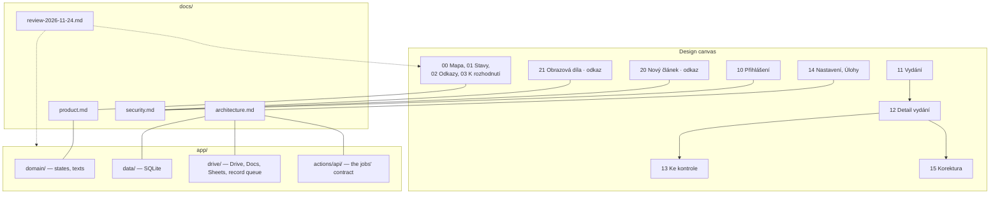

# Review of design, product, architecture and security, 24 Nov 2026

The design canvas (pages `00`–`21`, version of 24 Nov 2026) read against what the app is meant to
be ([AGENTS.md](../AGENTS.md)), against the code on `dev` after #129, and for security. Every
finding has an ID. _Where_ cites the design anchor or the file. _Resolution_ says what should
happen with it: an issue, a decision, or a fix already in this change. The three documents it
produced are [product.md](product.md), [architecture.md](architecture.md) and
[security.md](security.md).

## How the pieces fit

## Findings

### Design and product

| ID   | Finding                                                                                                                                                                                                                                                                                                                                                                                                                                                                                                                                                                                | Resolution                                                                                            | Where                                                                      |
| ---- | -------------------------------------------------------------------------------------------------------------------------------------------------------------------------------------------------------------------------------------------------------------------------------------------------------------------------------------------------------------------------------------------------------------------------------------------------------------------------------------------------------------------------------------------------------------------------------------- | ----------------------------------------------------------------------------------------------------- | -------------------------------------------------------------------------- |
| P-01 | **Artwork groups are drawn but not built, and no issue asks for them.** The design has the dialogs _Nová skupina_ and _Upravit skupinu_. Upload and consent work alike for an article and a group, and `00b` lets the editors-in-chief found a group. The code has no route or table for it: a batch and an artworks link both need an article. The app still promises groups in the empty state of the artworks table („…nebo poskytovatelé odkazem ke skupině“), and so do the README and copy-context. The Registr column _URL – Vytvořit skupinu obrazových děl_ is written empty. | Resolved by #133: groups are built as drawn, so the empty-state text and the README stay as they are. | `12e`, `12f`, `01d`, `02a`, `ARTWORKS_EMPTY_TEXT` in `app/domain/issue.ts` |
| P-02 | **_Spustit teď_ is drawn but not built.** `14d` gives every job a button that starts it through the script's `doPost`, and AGENTS.md says the app can do it. Nothing calls a `doPost`, and `SCRIPT_RUN_SECRET` is in `.env.example` but read nowhere.                                                                                                                                                                                                                                                                                                                                  | An issue; it needs a `doPost` in each job too. Until then AGENTS.md says it is planned.               | `14d`, `app/domain/jobs.ts`                                                |
| P-03 | **Issues made in the app get no comment e-mails.** _Připomínky ke článkům_ (`Comment_Digest`) is drawn in `14d` as a job that talks to the app. Today it reads only the Registr list _Vydání_, so an article in an app issue never gets its digest. It has no endpoint and is not in the app's list of jobs.                                                                                                                                                                                                                                                                           | An issue: an API for the digest and a switch in the script, with the old issues kept on the sheet.    | `14d`, `20e`                                                               |
| P-04 | **`03 K rozhodnutí` lists as open what is decided and built.** The rows on links (4, 5), the limit per link (15), Neběží (25), the account hint (41) and others carry _otevřené_, yet the code does exactly what they propose. Rows 6, 7 and 14 (groups) are open and unbuilt.                                                                                                                                                                                                                                                                                                         | `/ask-design`: mark the built rows _Rozhodnuto_ with their date; leave the group rows to P-01.        | `03a`, `03b`                                                               |
| P-05 | **copy-context names states the app does not have.** It lists the artwork state _Zpracovává se_ (`01b`); the app sends a batch inside the request, so the state is never shown. It names a clause _K odeslání_, while the app's row says _Čeká na odeslání_ and _K odeslání_ is only the Evidence's word. _Souhlas zaznamenán_ and _Souhlasí_ are not in it at all.                                                                                                                                                                                                                    | `/ask-copy` with `01b` beside it: one name per state, in copy-context and the canvas.                 | `docs/copy-context.md`, `01b`, `app/domain/approvals.ts`                   |
| P-06 | **The README described a skeleton.** It said "Status: skeleton", listed groups, and had no map of the written design.                                                                                                                                                                                                                                                                                                                                                                                                                                                                  | Fixed in this change.                                                                                 | `README.md`                                                                |
| P-07 | **No retention period for personal data.** Authors, providers, reply texts and answers are kept forever, and so are discarded batches. Only expired sessions are deleted.                                                                                                                                                                                                                                                                                                                                                                                                              | A decision: how long after an issue closes, and what stays as proof of a licence. Then an issue.      | [security.md](security.md#personal-data)                                   |
| P-08 | **An artworks link cannot be renewed.** `02a` decides this: the link is born with the article and ends with the issue. The link is in every author's welcome e-mail, though, and a leaked one uploads and sends requests until the issue closes (`S-05`).                                                                                                                                                                                                                                                                                                                              | A decision: keep `02a`, or give the article's „⋯“ _Vydat nový odkaz na díla_.                         | `02a`, `app/data/links.server.ts`                                          |

### Architecture

| ID   | Finding                                                                                                                                                                                                                                             | Resolution                                                                                                                | Where                                              |
| ---- | --------------------------------------------------------------------------------------------------------------------------------------------------------------------------------------------------------------------------------------------------- | ------------------------------------------------------------------------------------------------------------------------- | -------------------------------------------------- |
| A-01 | **Production hosting is decided but written only in #79.** Publikace runs behind the front server of the Fly app `cz-vednemesicnik`, not as an app of its own. AGENTS.md still says "one machine with a volume" without the host.                   | Written into [architecture.md](architecture.md#the-stack-and-where-it-runs); AGENTS.md follows when the repository moves. | #79, `app/publikace.server.ts`                     |
| A-02 | **Three of the four jobs that talk to the app run nowhere.** Article_Approvals exists only locally; Print_Handoff and Proofreading_Digest do not exist. Until they run, no final version is sent, no print folder is filled and no digest goes out. | Existing issues #96, #119, #86.                                                                                           | [architecture.md](architecture.md#background-work) |
| A-03 | **Unsent uploads are binned only at startup and on the next upload.** No timer runs the 24-hour sweep, so on a quiet deployment they stay for days.                                                                                                 | A small issue: run the sweep from the record queue's timer.                                                               | `app/drive/artworks-setup.server.ts`               |
| A-04 | **The database has no backup of its own yet.** The volume is the only copy until the host's backup covers `db/migrations` and the Publikace file.                                                                                                   | Part of #79.                                                                                                              | #79                                                |
| A-05 | **The Evidence never shows _Upraveno po schválení_.** A marked article is _K finalizaci_ there whatever followed, and the `final_versions` trigger ignores `doc_revised_at`.                                                                        | A decision: does the record carry a derived state at all? If yes, a new trigger.                                          | `app/domain/record.ts`                             |

### Security

| ID   | Severity   | Finding                                                                                                                                                                                                                                                                                                                                    | Resolution                                                                                                                           | Where                                                       |
| ---- | ---------- | ------------------------------------------------------------------------------------------------------------------------------------------------------------------------------------------------------------------------------------------------------------------------------------------------------------------------------------------ | ------------------------------------------------------------------------------------------------------------------------------------ | ----------------------------------------------------------- |
| S-01 | medium     | **Every safe default depends on `NODE_ENV === 'production'` in the record the host hands in.** A host that forgets it starts the app without refusing anything: a public session secret, a fixed Drive key, any audience accepted on `/api/v1`, cookies without `Secure`. This becomes likely once a front server builds the record (#79). | An issue: production by default, development only when asked for, or refuse the fallbacks whenever `APP_ORIGIN` is not local.        | `app/auth/environment.server.ts`, `app/publikace.server.ts` |
| S-02 | low–medium | **Every POST body is parsed before any check.** `formData()` runs ahead of the session, the link and the token, with the library's default limits of tens of MB in memory. That includes `/api/v1` and a multipart request to an upload.                                                                                                   | An issue: small limits for `formData()`, and none at all under `/api/` and for the raw upload.                                       | `app/router.ts`                                             |
| S-03 | low–medium | **A request without a cookie writes a session row for 7 days.** The CSRF token is made on every request, which saves the session, so a crawler grows the database for a week. Unverified: needs a test.                                                                                                                                    | An issue, after the test: a token only where a form is drawn, and a periodic purge.                                                  | `app/data/session-storage.server.ts`                        |
| S-04 | low        | **The app sets no security headers.** It sends no CSP, `frame-ancestors`, `nosniff` or `Referrer-Policy`, and no `no-store` on signed-in pages. Behind a shared front server, a sibling site on the same domain could frame a one-click form.                                                                                              | An issue: one headers middleware; HSTS if the host does not add it.                                                                  | `app/router.ts`                                             |
| S-05 | low        | **A leaked artworks link stays usable until the issue closes.** It is P-08 seen from security.                                                                                                                                                                                                                                             | With P-08.                                                                                                                           | `02a`                                                       |
| S-06 | low        | **One leaked article link can spend the whole day's mail cap.** 30 articles with 10 authors each is the default cap of 300, which then blocks consent requests and resends. The article name an attacker types reaches the subject of mail from `publikace@`.                                                                              | An issue: a budget per link and a reserve for the editors' own sends.                                                                | `app/drive/article-setup.server.ts`                         |
| S-07 | low        | **Names accept control characters, and the address check is loose.** A newline reaches an e-mail subject, a Drive name and a cell. Names and addresses also go to the jobs as Gmail search terms.                                                                                                                                          | An issue: refuse control characters in every field and use a stricter address pattern; check Reply_Check's search in its repository. | `app/domain/public/article-form.ts`, `artwork-form.ts`      |
| S-08 | info       | **Each Evidence lies in the issue folder, which is shared by link.** Its link alone shows every author's and provider's address. Its protection stops edits, not reading.                                                                                                                                                                  | A decision: accept and document it, or keep the Evidences outside the shared tree.                                                   | `app/drive/sheets.server.ts`                                |
| S-09 | info       | **Link keys are stored in plain text.** A copy of the database yields every live link.                                                                                                                                                                                                                                                     | Store a SHA-256 of the key, with the next change to links.                                                                           | `app/data/links.server.ts`                                  |
| S-10 | info       | Retention of personal data: P-07.                                                                                                                                                                                                                                                                                                          | With P-07.                                                                                                                           | —                                                           |
| S-11 | info       | **Cancelling a final version bins its PDF wherever it is now.** Other cleanups check the folder first. A PDF somebody moved would go to the bin, against _never touch what a person moved_.                                                                                                                                                | A small fix.                                                                                                                         | `app/drive/final-version.server.ts`                         |
| S-12 | info       | **`SESSION_SECRET` is split without trimming**, so `new, old` breaks a rotation.                                                                                                                                                                                                                                                           | A small fix.                                                                                                                         | `app/auth/environment.server.ts`                            |
| S-13 | info       | **A proofreader can learn the names of closed issues' articles** by trying ids in `/proofreading?article=`.                                                                                                                                                                                                                                | Accept, or answer a closed issue's article like an unknown one.                                                                      | `app/actions/proofreading/controller.tsx`                   |

## Still open

Decisions to make before the issues that depend on them:

1. Artwork groups: build them as drawn, or take them out of the design and the texts (P-01).
2. Retention of personal data and what stays as proof of a licence (P-07, S-10).
3. Renewing an artworks link (P-08, S-05).
4. Whether the Evidence lives in the link-shared issue folder (S-08).
5. Whether the record carries the derived _Upraveno po schválení_ (A-05).

Issues to file, each on its own: P-01, P-02, P-03, A-03, S-01, S-02, S-03 (after its test), S-04,
S-06 and S-07. The small fixes S-11 and S-12 can share one. P-04 and P-05 go through
`/ask-design` and `/ask-copy`.
