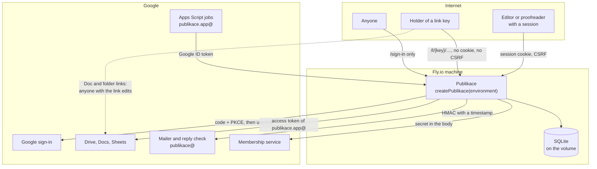

# Security and privacy

What Publikace protects, from whom, and how. Read it with [architecture.md](architecture.md).
The findings of the review that are not fixed yet are in
[review-2026-11-24.md](review-2026-11-24.md), each with an ID such as `S-01`.

## What is worth protecting

| Asset                                                                                                          | Why it matters                                                                                              | Where it lives                                                                                      |
| -------------------------------------------------------------------------------------------------------------- | ----------------------------------------------------------------------------------------------------------- | --------------------------------------------------------------------------------------------------- |
| Refresh token of `publikace.app@`                                                                              | full `drive` scope: it reads, writes and bins everything on _Publikace_ and in the account's own _Můj disk_ | `drive_account`, AES-256-GCM under `DRIVE_TOKEN_KEY`                                                |
| `DRIVE_TOKEN_KEY`, `SESSION_SECRET`, `GOOGLE_CLIENT_SECRET`, `MAIL_SEND_SECRET`, `GAS_GROUP_MEMBERSHIP_SECRET` | decrypt the token, forge a session, send mail as `publikace@`, ask about group membership                   | `.env` locally, `fly secrets` in production; never in the repository                                |
| Sessions                                                                                                       | each one is a signed-in editor-in-chief or proofreader                                                      | `sessions` table; cookie with a signed id                                                           |
| The access list and the proofreaders' address                                                                  | decide who signs in and who is an administrator                                                             | `access_accounts`, `access_groups`, `proofreaders`                                                  |
| Link keys                                                                                                      | each one creates articles, uploads files and starts e-mails from `publikace@`                               | `links.key`                                                                                         |
| Personal data: names and addresses of authors and providers, reply texts, editors' names                       | people outside the newsroom, under GDPR                                                                     | the database, every Evidence, the licence PDFs, Gmail                                               |
| Proof of consent                                                                                               | the legal record of a licence                                                                               | the archived Gmail conversation in `Licence`; the licence PDF and its SHA-256 quoted in the request |
| The API                                                                                                        | its claims return authors' addresses, its reports set consent states                                        | `/api/v1/*`                                                                                         |
| The mail budget                                                                                                | the Gmail quota of `publikace@`, which the jobs and the answers need too                                    | `public_mail_log`, `PUBLIC_MAIL_PER_DAY`                                                            |

## Trust boundaries

The dotted line is not the app's: Drive's link sharing lets anybody holding a Doc's or a folder's
link edit it. That is the product's decision ([product.md](product.md#rules-every-screen-follows)),
and it is why a link is never put where it would be read by more people than it is meant for.

## Threats and controls

### Signing in

- **Only Google, only the domain, only the listed.** The OAuth code flow carries `state` and PKCE
  (S256). The claims come from Google's userinfo over the back channel. The account must have
  `email_verified`, be on `AUTHORIZED_DOMAIN` and carry `hd` equal to it, and then be named in
  Přístup or be a member of a listed group (`app/auth/access.server.ts`). The domain alone is
  not enough: everybody in the newsroom has an account on it.
- **A session lasts 7 days from sign-in, fixed.** Activity does not extend it (`03` row 3). The
  cookie is `HttpOnly`, `SameSite=Lax` and `Secure` in production. The id is rotated at sign-in and
  sign-out, and sign-out is a `POST` (`03` row 38).
- **Roles are asked again every 10 minutes.** An unreachable membership service denies the
  request without signing anybody out, and asks again after a minute. The administrator flag is
  read on every request. Removing a named account deletes its sessions in the same transaction.
  Removing a group or changing the proofreaders' address takes effect within 10 minutes; that is
  by design.
- **Who may change access.** Only an administrator, always a named account, re-checked inside the
  transaction. The last administrator cannot be removed or demoted. The membership service
  answers only for groups in its own `allowedGroups` (`03` rows 26, 27).

### Who sees what

- Every editor screen is behind `requireEditor()`, and `/` and `/proofreading` are behind
  `requireProofreading()`. A proofreader gets 403 in place (`10d`).
- An id in a path is looked up only within the issue named in the path, so changing it does not
  reach another issue's article or batch.
- On `/proofreading` a proofreader acts only on their own take. An editor-in-chief acts on any.

### Links

- **A key is 12 characters of 62, drawn without bias from a CSPRNG**, about 71 bits. It carries no
  Drive ID and no name. An unknown key and a revoked one draw the same page, as does a key of a
  removed issue, article or group.
- **A link does one thing in one place.** An article link creates articles in its issue. An
  artworks link uploads to its one article or its one artwork group. Only an editor-in-chief
  creates a group, in the issue detail, so no link creates one. A form key of another link is
  refused, and an upload is removed only by the form that made it.
- **Limits stop a mistake and an abuse.** 30 sends an hour per link, 60 uploads an hour per
  artworks link, consent requests to at most 5 addresses a day per link, and a daily cap on all
  e-mails started from link pages ([product.md](product.md#limits)).
- **The key stays out of the log.** The request log redacts it. `/l/…` pages answer `noindex` and
  `no-store`.
- **The form key is an idempotency key, not a defence.** The page picks it, so a retry after a
  lost answer creates nothing twice. A script can choose its own, so it does not count against
  automation.

### Cross-site requests

The `csrf` middleware checks `Origin` against `APP_ORIGIN` and a token kept in the session. For
`/l/…` and `/api/…`, `skipWithoutSession()` removes the session, the sign-in and CSRF together. A
page there is protected by its key, or by the job's token, instead. A page under `/l/` or `/api/`
that needs a session belongs behind a guard instead.

### The API

- **Every call proves who made it.** A bearer Google ID token is checked for:
  - an RS256 signature against Google's keys;
  - the issuer;
  - an audience in `SCRIPT_TOKEN_AUDIENCE`;
  - its expiry;
  - `email_verified`;
  - the e-mail of `SCRIPT_JOB_ACCOUNT`.
- **The token is checked before the body is read**, and a body over 8 MiB is refused.
- **A job claims before it acts and reports with the run's key.** What a claim returns is leased
  for 10 minutes. A report for an unknown or closed run gets 409. A sent clause is never turned
  back into a failed one.

### Outbound calls

- **The Mailer** gets an envelope signed with HMAC-SHA256 over the timestamp and the payload, and
  refuses one older than 5 minutes. Every message carries an idempotency key.
- **The membership service** gets its secret in the body over HTTPS. A replayed request only
  repeats a yes or a no (`03` row 40).
- **The Drive token** is sealed with AES-256-GCM, with a random IV, and the key must be 32 bytes.
  Only `DRIVE_ACCOUNT_EMAIL` with the `drive` scope and a refresh token is accepted when the
  account is connected (`14h`).

### Files and what is written out

- **An upload is identified by its bytes**, not by its name or the type the browser declared.
  A file that is not an image is kept as `.bin` and refused on its card. It is stored as its
  SHA-256 with an extension, and nothing uploaded is ever served back by the app.
- **Text from a form is escaped wherever it lands.** Pages escape it through JSX, and e-mails and
  licence HTML through `escapeHtml`. Sheets are written with `valueInputOption: RAW`, so a cell
  that starts with `=`, `+`, `-` or `@` stays text. Drive queries escape their quotes.
- **The app never deletes for good and never shares.** It only moves files to the bin, found by
  stored IDs and the attempt's key. It sets no permission on any file.

### Startup and configuration

- **Production never falls back.** `createPublikace` refuses to start without the domain, the
  origin, the OAuth client, the secrets, the Drive account, the folders, the Mailer, the
  membership service and the job account. It also refuses to start when nobody could ever change
  the access list.
- **The fake app refuses production**, and binds only to `127.0.0.1`.
- **`.env` is never opened by tools or agents**, and the repository holds only fictional data on
  the `.test` domains ([AGENTS.md](../AGENTS.md#data-rules)).

## Accepted risks

- **A forwarded link works for whoever holds it.** That is the price of no sign-in from a
  messenger's browser (`02a`). It is limited to one action in one place, and it can be renewed
  (article links) or ends with the issue.
- **A Doc's link is the right to edit it.** An author outside the domain needs no account. A
  person who should no longer edit is removed by moving the file, not by the app.
- **The record may lag.** A sheet that does not answer is a log line `[drive] … was not written`,
  nothing on a screen (`00d`), and the nightly rewrite mends it.
- **Closing an issue leaves its files shared.** Cutting the inherited link sharing takes a Manager
  of the shared drive, which `publikace.app@` is not (#120).

## Personal data

| Data                                                                | Whose                          | Why it is kept                                            | Kept until                                                 |
| ------------------------------------------------------------------- | ------------------------------ | --------------------------------------------------------- | ---------------------------------------------------------- |
| Names and addresses of authors                                      | outside the newsroom           | the welcome e-mail, the clauses, the record of who agreed | not decided (`S-10`)                                       |
| Names and addresses of providers, author and source of each artwork | outside the newsroom           | the licence and its consent                               | not decided (`S-10`)                                       |
| Reply texts and answers                                             | both sides of the conversation | the decision in _Ke kontrole_                             | not decided; the proof itself is the archived conversation |
| Editors' names on steps                                             | the newsroom                   | who verified a consent, took or marked a text             | not decided                                                |
| Sessions                                                            | the newsroom                   | sign-in                                                   | deleted after they expire                                  |

Until a retention period is decided, nothing personal is deleted except expired sessions.
