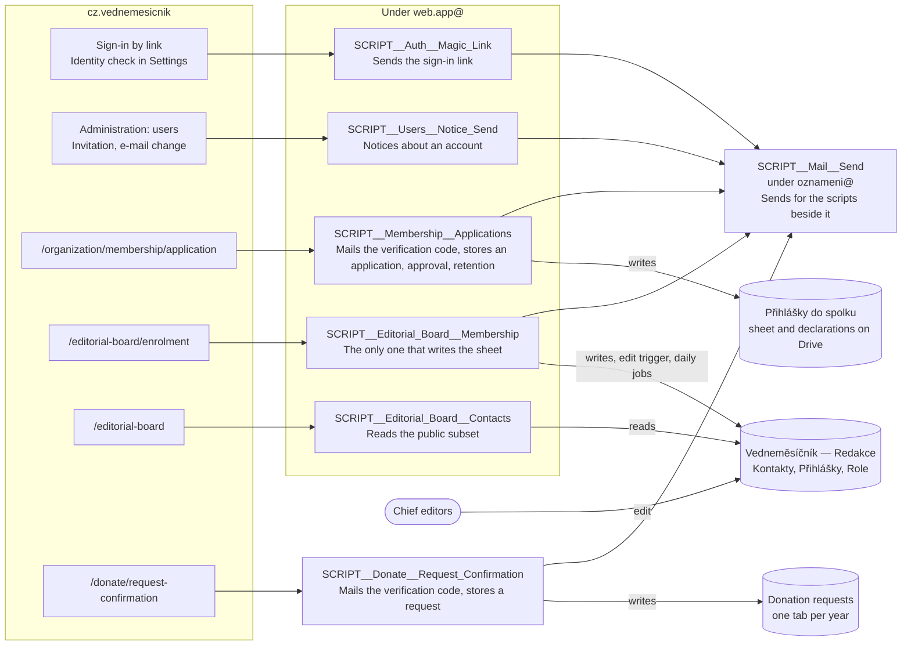
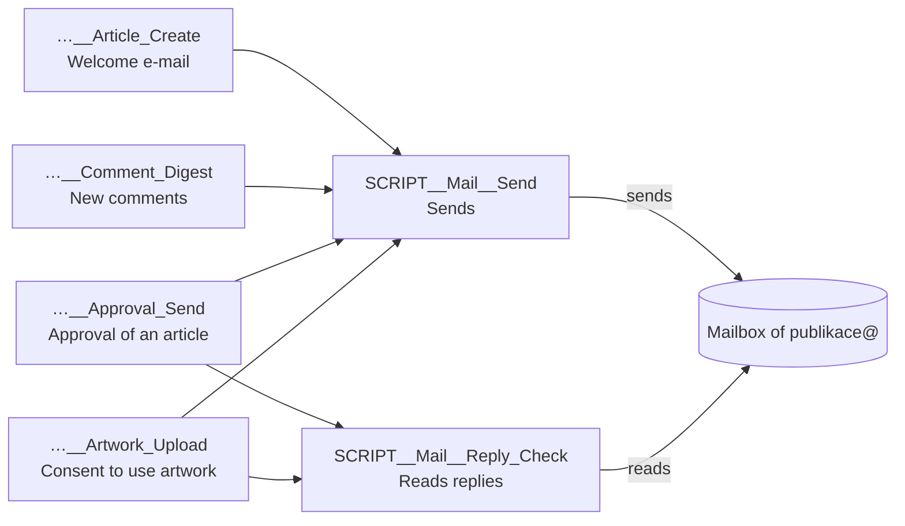

# Apps Script web apps

Which Google Apps Script does what for the web. The scripts are split by privilege, one per set of
caller, recipients, data and deploying account (log 0037), and a script that holds secrets or runs
installable triggers is never bound to a file people edit (log 0059). Each lives in its own private
repository, whose README has its setup.

## What the web calls

The endpoints are registered in `constants/gas-endpoints.ts`. Each answers a `doGet` with its JSON
Schema, which `pnpm gas:schema:fetch <name>` saves under `schemas/<name>/`.

| Endpoint | Script | Called from | Protected by |
| -------- | ------ | ----------- | ------------ |
| `magic-link` | `SCRIPT__Auth__Magic_Link` | `app/utils/send-magic-link-email.server.ts`: sign-in by link, the identity check in Settings | signed request, `GAS_MAGIC_LINK_SECRET` |
| `users-notice` | `SCRIPT__Users__Notice_Send` | `app/utils/users-notice/send-users-notice.server.ts`: the invitation, the e-mail change notice | signed request, `GAS_USERS_NOTICE_SECRET` |
| `editorial-board` | `SCRIPT__Editorial_Board__Contacts` | `app/utils/editorial-board.server.ts`: the `/editorial-board` loader | secret in the body, `GAS_EDITORIAL_BOARD_SECRET` |
| `editorial-board-membership` | `SCRIPT__Editorial_Board__Membership` | `app/utils/editorial-board-enrolment/send-enrolment-email.server.ts`: the enrolment form. `app/utils/editorial-board-membership.server.ts`: its confirmation, and the answers from the re-confirmation e-mails | signed request, `GAS_EDITORIAL_BOARD_MEMBERSHIP_SECRET`; the e-mails' links are signed the other way, by the script with `LINK_SECRET` and checked against `GAS_EDITORIAL_BOARD_LINK_SECRET` |
| `donation-confirmation` | `SCRIPT__Donate__Request_Confirmation` | `app/utils/donation-request/send-donation-verification-code-email.server.ts`: the code that confirms the donor's address. `app/utils/donation-request/submit-donation-request.server.ts`: the request for a tax confirmation, sent only after the code (log 0083) | signed request, `GAS_DONATION_CONFIRMATION_SECRET`; the code is made and checked by the app alone, with `DONATION_VERIFICATION_SECRET` |
| `membership` | `SCRIPT__Membership__Applications` | `app/utils/membership-application/send-verification-code-email.server.ts`: the code that confirms the applicant's address. `app/utils/membership-application/submit-membership-application.server.ts`: the membership application | signed request, `GAS_MEMBERSHIP_SECRET`; the code is made and checked by the app alone, with `MEMBERSHIP_VERIFICATION_SECRET` |

The web never sends e-mail itself and holds no mail service secret: a script behind it renders the
message and hands it to `SCRIPT__Mail__Send`.

`postGasRequest` walks the redirect from `/exec` itself and logs each hop as a `[gas]` line. Only
`magic-link`, `editorial-board-membership`, both actions of `donation-confirmation` and the
verification code of `membership` try a transport failure again, once, through
`postSignedGasRequest` (log 0061). `editorial-board-membership` answers a repeat with its first
result (log 0064), a code's e-mail is keyed by the code (log 0073), and a donation request is
stored once per `requestId` (log 0083). The others do not:

- `users-notice` must not: its e-mail change notice is keyed on the request signature, and a retry
  has a new one.
- `editorial-board` has no need to: the page serves its last good data and asks again after the TTL.
- `membership`'s submit could, by its `code`, but two attempts of 60 s would outlast Cloudflare's 100 s. The
  application stays in its cookie, so the person can send it again.

## Without an endpoint of its own

- `SCRIPT__Mail__Send` is called by the scripts in the diagram and the Publication scripts below,
  never by the web. It is one codebase deployed once per sending mailbox, because a web app sends as
  the account that deployed it. The billing app calls its own copy under `fakturace@`.
- `SCRIPT__Mail__Reply_Check` reads replies for the Publication scripts below, holding only
  `gmail.readonly` (log 0071). It is deployed per mailbox too, and today only under `publikace@`.
- `SCRIPT__Toolkit` is a library, not a web app. The scripts share its primitives, pinned by version
  in each manifest.

## The other scripts

The web does not call these. They are here so a name found in `apps-script-ops` has a place.

| Area | Scripts | What for |
| ---- | ------- | -------- |
| Billing, for `cz.vednemesicnik.billing` | `SCRIPT__Auth__Group_Membership`, `SCRIPT__Drive__Invoice_Pdf`, `SCRIPT__Drive__Database_Backup`, `SCRIPT__Sheets__Accounting_Export`, `SCRIPT__Mail__Bounces`, `SCRIPT__Mail__Send` | Sign-in by group, the invoice PDF on Drive, the nightly backup, the accountant's sheet, delivery failures, sending an invoice |
| Invoices | `SCRIPT__Billing__Invoices` | A web app of its own: a form, a sheet and the PDF on Drive |
| Publication, under `publikace@` | `SCRIPT__Publication__Issue_Create`, `…__Article_Create`, `…__Article_Approve`, `…__Approval_Send`, `…__Artwork_Upload`, `…__Artwork_Group_Create`, `…__Comment_Digest`, `…__Designer_Handoff` | Preparing a printed issue in Google Docs and Drive, from creating it to the designer's folder |

Under `publikace@`, only `SCRIPT__Mail__Send` sends and only one script reads (log 0071). The scripts
that mail someone hold no Gmail access:

Each calls them with its own `MAIL_SEND_*` and `MAIL_REPLY_CHECK_*` Script Properties. A script
elsewhere in the estate that mails someone reads `MAIL_SEND_*` the same way, through `Toolkit.sendMail`.
