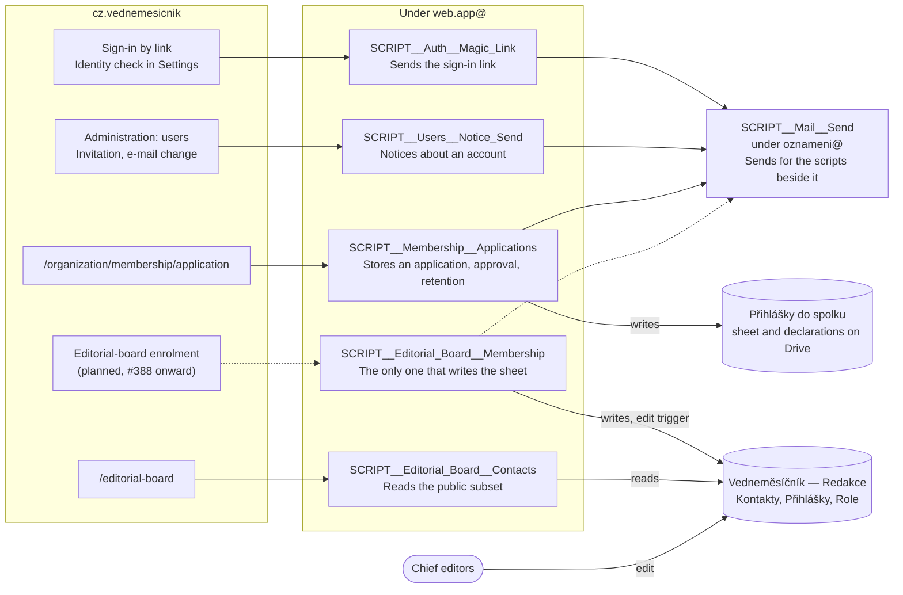

# Apps Script web apps

Which Google Apps Script does what for the web. The scripts are split by privilege, one per set of
caller, recipients, data and deploying account (log 0037), and a script that holds secrets or runs
installable triggers is never bound to a file people edit (log 0059). Each lives in its own private
repository, whose README has its setup.

A dashed line is planned. `SCRIPT__Editorial_Board__Membership` has only its setup and its edit
trigger today.

## What the web calls

The endpoints are registered in `constants/gas-endpoints.ts`. Each answers a `doGet` with its JSON
Schema, which `pnpm gas:schema:fetch <name>` saves under `schemas/<name>/`.

| Endpoint | Script | Called from | Protected by |
| -------- | ------ | ----------- | ------------ |
| `magic-link` | `SCRIPT__Auth__Magic_Link` | `app/utils/send-magic-link-email.server.ts`: sign-in by link, the identity check in Settings | signed request, `GAS_MAGIC_LINK_SECRET` |
| `users-notice` | `SCRIPT__Users__Notice_Send` | `app/utils/users-notice/send-users-notice.server.ts`: the invitation, the e-mail change notice | signed request, `GAS_USERS_NOTICE_SECRET` |
| `editorial-board` | `SCRIPT__Editorial_Board__Contacts` | `app/utils/editorial-board.server.ts`: the `/editorial-board` loader | secret in the body, `GAS_EDITORIAL_BOARD_SECRET` |
| `membership` | `SCRIPT__Membership__Applications` | `app/utils/membership-application/submit-membership-application.server.ts`: the membership application | signed request, `GAS_MEMBERSHIP_SECRET` |

The web never sends e-mail itself and holds no Mailer secret: a script behind it renders the message
and hands it to the Mailer.

## Without an endpoint of its own

- `SCRIPT__Editorial_Board__Membership` is not called by the web yet. It adds the columns and the tab
  and runs the edit trigger; see [Editorial board from a Google Sheet](_editorial-board-google-sheet.md).
  Its endpoint arrives with #388.
- `SCRIPT__Mail__Send` is called by the scripts in the diagram, never by the web. It is one codebase
  deployed once per sending mailbox, because a web app sends as the account that deployed it. The
  billing app calls its own copy under `fakturace@`.
- `SCRIPT__Toolkit` is a library, not a web app. The scripts share its primitives, pinned by version
  in each manifest.

## The other scripts

The web does not call these. They are here so a name found in `apps-script-ops` has a place.

| Area | Scripts | What for |
| ---- | ------- | -------- |
| Billing, for `cz.vednemesicnik.billing` | `SCRIPT__Auth__Group_Membership`, `SCRIPT__Drive__Invoice_Pdf`, `SCRIPT__Drive__Database_Backup`, `SCRIPT__Sheets__Accounting_Export`, `SCRIPT__Mail__Bounces`, `SCRIPT__Mail__Send` | Sign-in by group, the invoice PDF on Drive, the nightly backup, the accountant's sheet, delivery failures, sending an invoice |
| Invoices | `SCRIPT__Billing__Invoices` | A web app of its own: a form, a sheet and the PDF on Drive |
| Donations | `SCRIPT__Donate__Request_Confirmation` | Stores a request for a tax confirmation. Its README names a form at `/donate/request-confirmation`, which `app/routes.ts` does not have today, and the app has no endpoint for it |
| Publication, under `publikace@` | `SCRIPT__Publication__Issue_Create`, `…__Article_Create`, `…__Article_Approve`, `…__Approval_Send`, `…__Artwork_Upload`, `…__Artwork_Group_Create`, `…__Comment_Digest`, `…__Designer_Handoff` | Preparing a printed issue in Google Docs and Drive, from creating it to the designer's folder |
