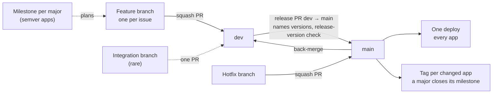
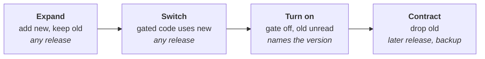
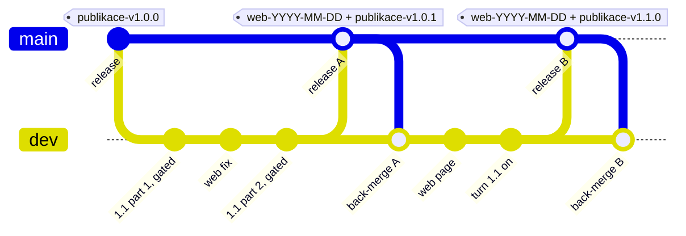

# Branching Model

The repository uses a persistent `dev` integration branch to decouple **merging a
feature** from **deploying to production**. Merges to `main` deploy; merges to `dev`
do not.

- `dev` is the **default branch** — feature, fix, and Dependabot PRs target it
  automatically.
- `main` is the **production branch** and the only deploy source.

## Flow



- **Feature / fix:** branch off `dev`, PR back into `dev`. No deploy. A change too large
  for one diff runs as a chain of [stacked PRs](#stacked-prs). User-visible work that is not
  to be released yet goes in [behind a gate](#unreleased-work-behind-a-gate).
- **Release:** PR `dev → main`. This is the only moment a deploy happens.
- **Hotfix:** branch off `main`, PR directly into `main` (deploys), then back-merge
  into `dev`.

## Unreleased work behind a gate

A release takes everything on `dev`, for every application. So new user-visible work that is
not to be released yet still merges into `dev`, hidden in production: it shows where the app's
own rule says it is not production (local development, tests, the fake app; each app's
**Release gate** names the rule) and is hidden when the app runs in production.

- **One helper per application.** Each application's guide names it (its `AGENTS.md` § For the
  workflow skills, **Release gate**), and it is written by the application's own rules. Every
  gate calls it, never `process.env.NODE_ENV` directly, so one `git grep` lists every gate. The
  first issue that needs a gate adds the helper.
- **The server is gated too.** A gated route or action answers 404 in production, as if it did
  not exist; hiding the link alone leaves it reachable.
- **Migrations cannot be gated**, because they run on deploy; they go
  [expand, then contract](#migrations-expand-then-contract).
- **Turning it on is its own PR.** The PR that removes the gate is the step that releases the
  work, and the release that carries it names the version it turns on. When that version is a
  major of an application tagged by semver, the PR belongs to the major's milestone
  ([\_workflow-skills.md](_workflow-skills.md) § Planning a version). A release carrying only
  gated work gives such an application the next patch (`publikace-v1.0.1`).
- **Work that cannot be gated** — a change of the host, a dependency, a shared layout, a
  schema whose old and new shape cannot coexist — goes to a short-lived integration branch off
  `dev` as a rare exception: its PRs target that branch, the workflows' `pull_request.branches`
  list gets it for as long as it lives, and it merges into `dev` in one PR when it is ready to
  ship.

### Migrations: expand, then contract

A migration runs on the deploy, for every release, so it cannot wait behind a gate. A schema
change is split so that each release runs on both the old and the new structure:



1. **Expand.** A migration adds the new structure beside the old one. It can ship in any
   release; the running code does not notice.
2. **Switch.** Gated code uses the new structure, writing both or backfilling where it needs
   to; the code production runs keeps using the old one.
3. **Turn on.** The PR that removes the gate also stops reading the old structure, and its
   release names the version.
4. **Contract.** Dropping the old structure is an issue of its own, and ships in a later
   release than the turn-on, never the same one, so rolling back to the previous image still
   works. It is the one destructive step: the web's deploy takes the pre-migration backup
   itself, of the web's database and Publikace's alike.

When the old and the new structure cannot coexist — a new constraint the old data breaks, say
— a gate does not help. That is the integration branch above: data and code land in one
release, with a backup first.

## Merge methods

The merge method matters: squashing a `dev → main` release would rewrite the commits
and permanently diverge the two branches.

| PR | Method |
| --- | --- |
| feature/fix → `dev` | squash |
| release `dev → main` | **merge commit** — squash would permanently diverge the branches |
| hotfix → `main` | squash |
| back-merge `main → dev` | **merge commit** |

A squash lands the PR title as the commit subject, so every PR title is a Conventional
Commit; `.github/workflows/pr-title.yml` checks it (and allows `release:` into `main`).

## Stacked PRs

One issue too large for a single reviewable diff becomes an ordered chain: each PR targets
the branch below it, so every diff shows only its own work. The bottom PR targets `dev`.

**A stacked PR has no CI.** Every workflow triggers on `pull_request` with
`branches: [main, dev]`, and that filter is on the **base**: a PR aimed at a feature branch
never fires it, and GitHub reports "no checks reported". Until a child is retargeted, run the
gates of the app it touches locally on that branch and say so in the PR.

**Deleting a branch that is the base of an open PR closes that PR**, and a closed PR whose
base no longer exists cannot be reopened — the work comes back only as a new number. This
repository has "Automatically delete head branches" on, so merging the parent deletes its
branch whether or not `--delete-branch` is passed. Retarget every child **before** the
parent lands:

```bash
git rev-parse origin/<parent-branch>          # note <parent-tip> while the branch exists
gh pr edit <child> --base dev                 # retarget while the old base still exists
gh pr merge <parent> --squash --delete-branch
git fetch origin --prune
git rebase --onto origin/dev <parent-tip> <child-branch>
git push --force-with-lease origin <child-branch>
```

`--onto` is the load-bearing part. The parent's commits are one squashed commit on `dev`
now, but the child still carries them as its own ancestors; a plain rebase replays them
against a `dev` that already has their content. `<parent-tip>` is the parent branch's last
commit — everything after it is the child's own work, and that is all that should move.

The force-push is the one exception to append-only history on a PR branch, so it is asked
for, not assumed. It is also what starts the child's CI: the base is `dev` now, and the push
is the `synchronize` event the workflows listen for (a base change alone is an `edited`
event, which only `pr-title.yml` hears).

## Automated back-merge

`.github/workflows/sync-dev.yml` runs on every push to `main`. If `dev` is behind, it
opens a single PR `main → dev`; merging it stays a manual decision (merge commit).

After every release merge (`dev → main` merge commit) `dev` is behind by exactly that
merge commit, so the workflow opens a trivially mergeable back-merge PR. Merge it (merge
commit) to keep the histories converged.

The workflow uses a fine-grained PAT (`BACKMERGE_TOKEN`), not the default
`GITHUB_TOKEN`: PRs created with the workflow token do not trigger `pull_request`
workflows, so the required CI checks would sit as "expected" forever and block the
merge. The token is scoped to this repo with **Contents: read** and **Pull requests:
read & write**.

> **The back-merge PR's head is `main` itself**, so "Automatically delete head
> branches" would delete `main` on merge (it did once, and `main` was restored). This
> is prevented by a repository ruleset that **restricts deletions** on `main` and
> `dev`: auto-delete skips protected branches, so feature branches are still cleaned up
> automatically while `main`/`dev` survive. #143 folds this deletion rule into the
> fuller branch-protection ruleset.

## Versions

One deploy ships every application, but each has its own tags and GitHub Releases, so
`git tag` says which version of which application went out with which merge.

**After every merge into `main`** `.github/workflows/release.yml` looks at each `apps/<app>/`.
An application whose folder changed since its newest tag (with no tag yet: in the commits the
PR brings into `main`) gets a tag `<app>-<version>` on the merge commit and a Release of the
same name, whose notes are the commits that touched its folder. An unchanged application gets
nothing.

**Each application picks its style** in `RELEASE_STYLES` in `scripts/release-version.ts`; a
folder in `apps/` without one fails the `release-version` check on every PR.

| Style | Applications | Tag | Who picks the version |
| --- | --- | --- | --- |
| `date` | the web | `web-2026-11-27`, a second one that day `web-2026-11-27-2` | the day of the merge in Prague |
| `semver` | Publikace | `publikace-v1.1.0` | a release names it under `## Versions`; a hotfix is the next patch |

**Why two styles.** An application that plans its majors as milestones needs semver, since a
milestone needs its name before anyone knows the day it ships, and the number tells its users
what a release does to them. An application that ships continuously with no plan per version
is tagged by date. What makes releases continuous is the
one deploy from `dev`, not the numbering, so one repository holds both.

**Which part of a semver version moves**, in the application's own terms (its `AGENTS.md`
§ For the workflow skills, **Issue weighing**):

- **patch** — the release carries only fixes, or only work still behind a gate. A hotfix takes
  the patch by itself.
- **minor** — at least one new thing is turned on, and nobody who uses the application or
  calls it has to change anything for it.
- **major** — something its users have to relearn, an incompatible change to an API others
  call, or a data migration that needs somebody to act. A major is planned as a milestone
  (`<app>-v2.0.0`), its work lands on `dev` behind the gate, and the release that removes the
  gate names it.

A semver version is the next patch, minor or major after the application's newest tag. The
first one is always `v1.0.0`, and until a release names it the application stays untagged; a
release that names the first version tags it even when only the host changed. A hotfix never
gives a first version. The web's Releases carry the repository's "Latest" badge; the others do
not.

**Only a major is planned as a milestone**, titled after its tag, and the release that names
the major closes it ([\_workflow-skills.md](_workflow-skills.md) § Planning a version). A
patch or a minor has none. A release that changes such an application only with work still
[behind a gate](#unreleased-work-behind-a-gate) gives it the next patch, once it has a first
version. An illustration, with Publikace's 1.1 built behind its gate between two releases:



**Checked before the merge.** `.github/workflows/release-version.yml` (job `release-version`)
runs the same script on every PR into `main`, again when its body is edited, and shows each
application's tag in the run's summary. The `branch-protection` ruleset requires it. It fails when a changed semver application has no
version named, when a named version does not follow the newest tag or names an unchanged
application, and when a date application is given one. On a PR into `dev` it only checks the
styles.

**No code from the repository runs with a token that can write.** `release.yml` has two jobs:
`release-decide` checks out the merge commit and runs the script on a read-only token;
`release-tag` never checks anything out, re-validates each tag it is handed and writes the
tag and the Release through the API.

**The deploy works out the same tag for the image.** `deploy.yml` runs beside `release.yml`,
so it cannot count on the tag existing yet: it finds the PR the push merged and runs the script with
`MODE=version` for each application that shows its version (Publikace,
[apps/publikace/docs/architecture.md](../apps/publikace/docs/architecture.md) § The stack and
where it runs). An unchanged application runs its newest tag. A version that cannot be worked
out never stops the deploy: the image then carries the commit alone.

**When a run fails or is cancelled**, re-run it from the Actions page: the event is the same,
a tag already on the merge commit counts as done, and a missing Release is published. Merges
into `main` queue one run at a time, and GitHub keeps one waiting run: a third merge (or a
re-run) while one runs and one waits cancels the waiting one, so re-run when nothing waits. A
re-run after a later merge was tagged skips the application that tag covers, since its notes
already include those commits.

**When one application fails after the merge** (a hotfix took the patch the release named),
the others are tagged and the run fails for that one. The body is frozen in the event, so a
re-run fails again: tag it by hand with the next version after the newest tag (the one the
hotfix took), with `--latest=false` for every application but the web, and each `@name` in
backticks so the Release mentions nobody:

```bash
git log --no-merges --format='- %s (%h)' <previous-tag>..<merge-sha> -- apps/<app>/ |
  sed -E 's/(^|[^[:alnum:]_`])@([[:alnum:]_][[:alnum:]_./-]*)/\1`@\2`/g' > notes.md
gh release create <app>-v<version> --target <merge-sha> --title <app>-v<version> \
  --notes-file notes.md --latest=false
```

## Release procedure

1. Create the release PR with the named template and a `release:` title:

   ```bash
   gh pr create --base main --head dev --template release.md \
     --title "release: $(date +%F) — <theme>"
   ```

   The template lives at `.github/PULL_REQUEST_TEMPLATE/release.md`. GitHub prefills the
   **default** template (`.github/pull_request_template.md`) on every manually opened PR
   regardless of base branch — it's written for the common case, feature/fix → `dev`.
   `release.md` and `hotfix.md` are **named opt-in** templates that override the default
   when passed with `--template`. The template fills the PR body only; set the title
   yourself (e.g. `release: 2026-07-18 — admin tables & lists rollout`).
2. Fill in Summary / What ships / Versions / Deploy expectation. Under **Versions** name the
   version of each semver application the release changes (`- publikace-v1.1.0`); the
   `release-version` check's summary lists what every changed application would get.
3. Merge with a **merge commit** (never squash — see [Merge methods](#merge-methods)).

## Hotfix procedure

1. Branch off `main` (e.g. `fix/123-...`).
2. Create the hotfix PR with the named template and a `fix:` title:

   ```bash
   gh pr create --base main --template hotfix.md --title "fix: …"
   ```

   Squash merge into `main`. This deploys.
3. The push to `main` triggers `sync-dev.yml`, which opens a back-merge PR `main → dev`.
   Merge it (merge commit) to carry the fix back into `dev`.
